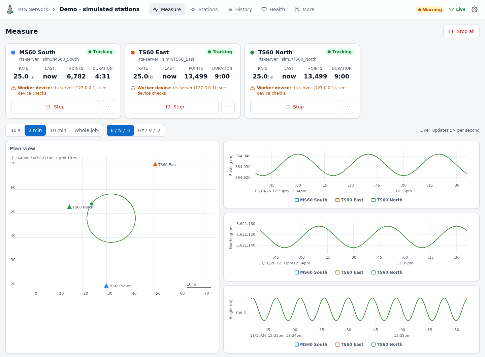
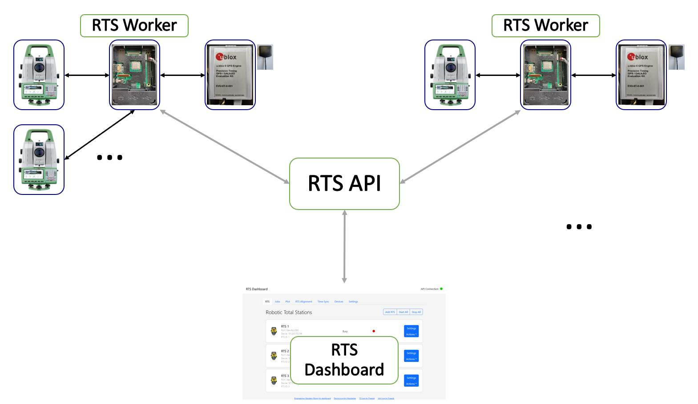

# Robotic Total Station Network

This repository contains the code for the Robotic Total Station Network (RTSN). An RTSN is a network of spatially distributed robotic total stations tracking the same or several moving objects, e.g. to generate reference trajectories in GNSS-denied environments or to track objects on construction sites where a single total station cannot keep a line of sight.



## Components

| Component | Runs on | Purpose |
|---|---|---|
| [rts-api](rts-api) | laptop / server / Raspberry Pi | Stores configuration, jobs and measurements (SQLite), detects problems, pushes live data to the dashboards |
| [rts-dashboard](rts-dashboard) | served by nginx next to the API | Web app with the tabs **Measure** (problems, stations with live values, sensor overview), **Plot** (live map and plots), **Data** (all measurements, downloads, instrument delay calibration from a circle measurement), **Sensors** (external sensors with live tracks and recording, time synchronization) and **Setup** (stations, Raspberry Pis, session). Works on phones; Android wrapper in [rts-android](rts-android) |
| [rts-worker](rts-worker) | Raspberry Pi at the total station | Controls one total station via GeoCOM, timestamps the measurements (GNSS/PPS disciplined clock) and uploads them |
| [external-sensors](external-sensors) | any device | Optional sensors (e.g. GNSS receivers) that stream positions to the API |



## How data flows (and why it is not lost)

```
total station ──serial──▶ worker ──▶ outbox (SQLite on the worker) ──websocket, batches──▶ API ──▶ database
                            │                                         ◀── acknowledgement ──┘
                            └──▶ CSV log on the worker                 API ──websocket──▶ dashboards (live)
```

- Every measurement gets a **sequence number** and is committed to the worker's **outbox** before anything else. It is deleted there only after the API confirmed that it is **committed to the database**. Network outages, API restarts and worker crashes therefore lose no data: the backlog is uploaded when the connection is back (the API ignores duplicates).
- A worker holds a **lease** on its job and renews it every second. If the API does not hear from it, the job shows *No contact* (the worker keeps measuring). It is only stopped by the user, never by a network problem.
- The API writes through a **single writer thread** (no lock contention), serves reads in a thread pool and never blocks its event loop. Live data, the target position and the problem detection work from memory, so the cost of the dashboards does not grow with the size of a session.
- **Problems** are reported only when something needs an action, in plain words (e.g. *TS60 North · Prism lost for 14 s*): device offline, clock not synchronized to GNSS, serial port missing, no data, no contact to the worker, low battery, disk full, overheating, measurements waiting for upload.
- Stopping a worker (`docker stop`, Ctrl+C) ends its running measurement cleanly; nothing is lost.
- Dashboards receive **pushed events** (live measurements 5× per second, job changes, problems every 2 s) instead of polling. A dashboard that was offline or asleep detects the gap from the sequence numbers and fills it from the API.

## Installation

Install the API and the dashboard on one machine with Docker:

```bash
git clone https://github.com/Engineering-Geodesy-Bonn/rts-network
cd rts-network
docker compose up -d --build
```

The dashboard is available at `http://<host>:8050`, the API at `http://<host>:8000` (documentation at `/docs`). Install a worker on every Raspberry Pi connected to a total station as described in the [worker README](rts-worker/README.md).

### Upgrading from version 1

Version 2 uses a new database file (`data/rts-api/rtsnet.db`). On its **first start the API imports the version 1 database** (`data/rts-api/database.db`) automatically. The old file is opened read-only and stays untouched, so you can go back to version 1 at any time. Every imported job is verified (number of measurements and a checksum of the distances); the result is shown in the dashboard under *Settings*. An interrupted import is resumed on the next start. A database can also be imported manually, e.g. a backup (`rtsapi import-legacy <file>`, idempotent).

All workers must be updated together with the API: the worker protocol changed.

## Testing without hardware

`tools/demo.py` runs the whole system on one computer: the API, the dashboard and three workers with simulated total stations that track the same moving prism, plus two simulated external sensors (a GNSS rover with time stamps that are 35 ms late, and an odometry sensor in its own coordinate frame). The time synchronization between the first station and the GNSS rover is started as well. Requires uv and npm.

```bash
python tools/demo.py                   # then open http://localhost:5173
python tools/demo.py --api-port 8100   # if port 8000 is taken
```

A total station with the port `sim://<name>` is simulated by the worker (25 Hz, prism moving on a circle). `tools/e2e.py` starts an API and several workers with simulated instruments, injects faults (API killed for 10 s, a worker killed with SIGKILL) and verifies that every measurement in the workers' logs arrived exactly once:

```bash
(cd rts-api && uv sync) && (cd rts-worker && uv sync)
python3 tools/e2e.py --rts 4 --duration 300 --chaos
```

The API has a unit test suite: `cd rts-api && uv run pytest`.

## License

The license of each component is specified in its folder. The RTS API and the RTS Dashboard are licensed under the GPLv3 license, the RTS Worker under the MIT license.
